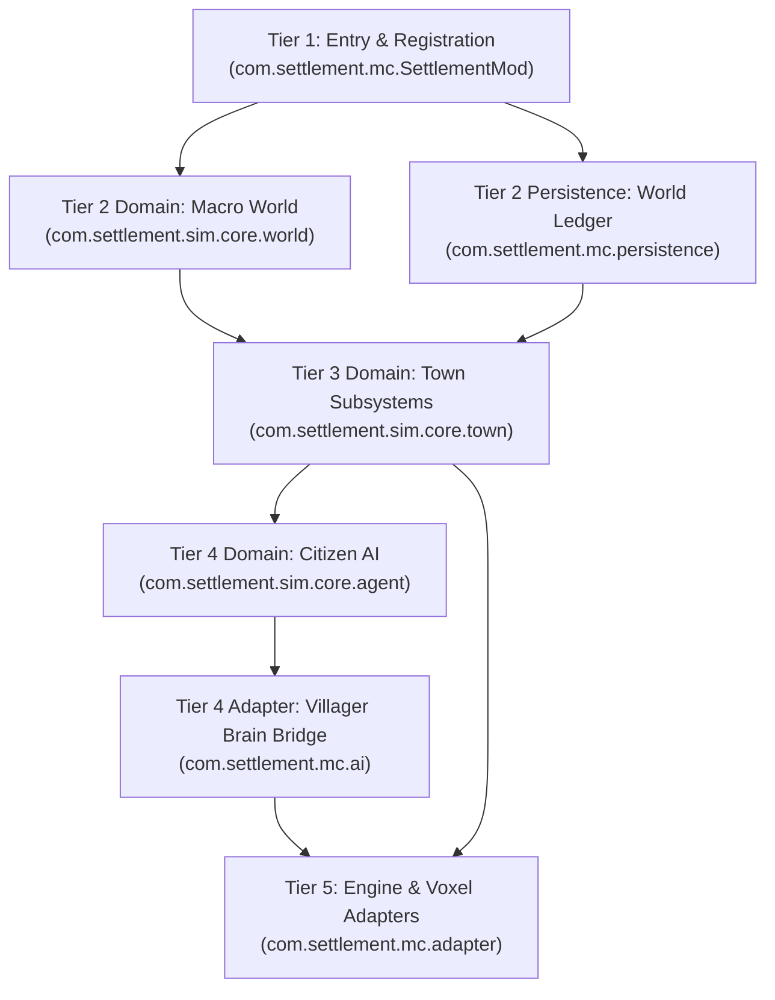

# Settlement Mod (`settlement`)

A self-growing, autonomous villager settlement simulation mod for **Minecraft 26.1+ (NeoForge, Java 25, unobfuscated)**. Built on Conzenian urban morphology, Malthusian/satisficing agrarian economics, a 100-day seasonal calendar, and utility-scored villager AI hooked into vanilla `Villager` brains.

---

## Current Status

**Active Phase:** Phase 0 (Toolchain & Pure-Java Simulation Sandbox).  
Scaffolding and architectural skeletons are in place; domain simulation implementation is in progress.

- [GitHub Milestones](https://github.com/Acidburn0x90/settlement/milestones)
- [GitHub Issues](https://github.com/Acidburn0x90/settlement/issues)
- Living Checklist: [tasks/todo.md](tasks/todo.md)

---

## Core Pillars

1. **Conzenian Urban Morphology:** Town layouts organically grow from fringe belts, plan units, and burgage plots (`DwellingZone` + `ExtensionYard`) following a lifecycle (`INSTITUTIVE`, `REPLETIVE`, `CLIMAX`, `FALLOW`).
2. **Malthusian & Satisficing Economics (Resilience Invariant):** Villagers operate on satisficing principles rather than hyper-optimization. Deficits and harsh conditions stall demographic growth at a subsistence equilibrium; **villages never collapse to zero population or extinguish**.
3. **100-Day Seasonal Calendar:** A target 100-day Minecraft year divided into four full seasons (`SPRING`, `SUMMER`, `AUTUMN`, `WINTER`) dictating temperatures, rainfall, and seasonal crop cycles via clean port interfaces (`SeasonPort`).
4. **Utility AI & Vanilla Brain Integration:** Villagers remain vanilla `Villager` entities with extended `Brain` behaviors (`MemoryModuleType`, `PoiManager`, and `BehaviorControl`), selecting actions dynamically via utility scoring (`UtilityScorer`).

---

## 5-Tier Hexagonal Architecture

The codebase enforces a strict hexagonal architectural split:
- **`com.settlement.sim.core.*`**: Pure Java 25 domain logic. **Strictly zero `net.minecraft.*` or `net.neoforged.*` imports**, enabling sub-second JUnit 5 test runs.
- **`com.settlement.mc.*`**: Thin Minecraft and NeoForge adapters, persistence (`SavedData` + `DataAttachments`), and voxel world mutators.



---

## Live Roadmap

| Phase | Description | Key Deliverables | Status |
|---|---|---|---|
| **Phase 0** | Java 25 Toolchain & Simulation Sandbox | Pure-Java sandbox, `Household`, `Stockpile`, Malthusian subsistence balance, JUnit 5 suite | **In Progress** |
| **Phase 1** | Persistence, Soil & Terrain Scanner | `WorldLedgerSavedData`, chunk soil `DataAttachments`, column slope scan, debug wand | **Planned** |
| **Phase 2** | Flood-Fill, Reservation & Brain Hooks | BFS room flood-fill, `TaskBoard` target reservations, custom `BehaviorControl` in `Villager` `Brain` | **Planned** |
| **Phase 3** | Burgage Plots & Physical Builder | Burgage plot lifecycle, dynamic soil yield curves, physical block-placing builder with stuck watchdog | **Planned** |
| **Phase 4** | ACO Roads, Fringe Belts & Demographics | 2D pheromone road generation, Space Syntax connectivity, contour farm flood-fill, Leslie demographic cohorts | **Planned** |
| **Phase 5** | Performance, Catch-Up & Trade Network | Tick throttling, offscreen elapsed-time catch-up math on chunk reload, gravity trade graph, 26.1 data-driven trades | **Planned** |

---

## Getting Started

### Prerequisites
- JDK 25 (Java 25 toolchain)
- Git

### Build & Test Commands
```bash
# Run pure-Java unit tests (fast JUnit 5 suite)
./gradlew test

# Full mod build
./gradlew build

# Launch client development environment
./gradlew runClient

# Launch dedicated server development environment
./gradlew runServer
```

For coding standards, architectural guardrails, and PR checklists, please see [CONTRIBUTING.md](CONTRIBUTING.md) and [AGENTS.md](AGENTS.md).
