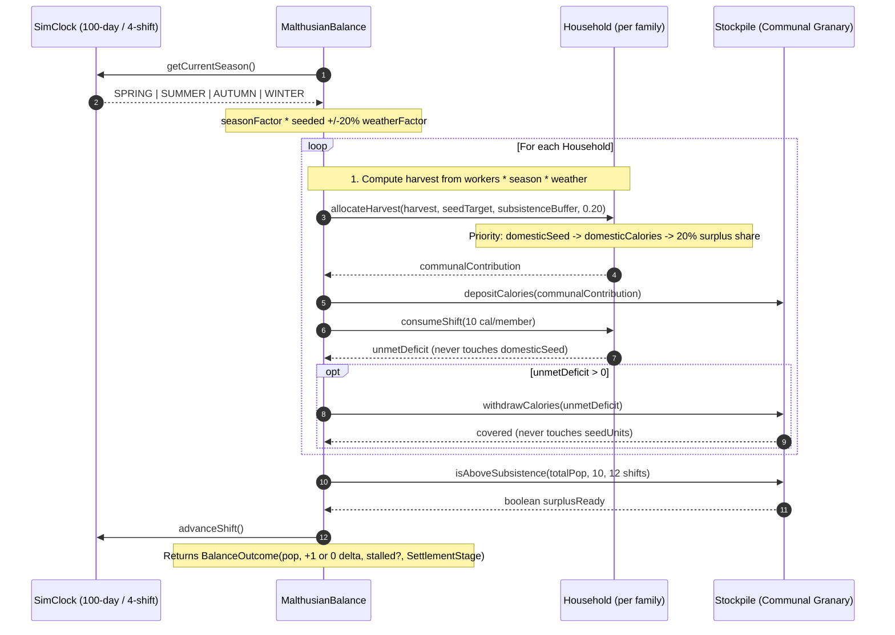

# Flow of Control — Per-Phase Architecture

This document tracks the live execution flow of the Settlement Mod as each phase is implemented.

---

## Phase 0: Pure-Java Economic & Demographic Shift Loop

Every **6,000 Minecraft ticks** (1 shift, 4 shifts/day, 100 days/year), `MalthusianBalance.tickShift(...)` executes one deterministic step:

---

## Upcoming Phases (Planned)
- **Phase 1:** `ServerLevel` tick -> `WorldLedgerSavedData` (`SavedData`) + `ChunkSoilAttachment` (`DataAttachments`) + `VoxelWorldAdapter` slope/connected-area scan.
- **Phase 2:** `Villager` `Brain` -> `UtilityScorer` -> `TaskBoard.tryReserve(pos, uuid)` -> `RoomValidator` BFS.
- **Phase 3–5:** `BurgageCycle` plot infill -> Physical Builder -> `PheromoneGrid` ACO roads -> `SettlementNetwork` Gravity/XTENT trade.
