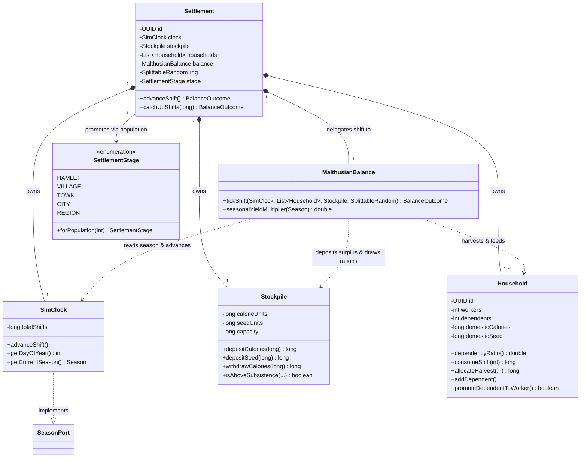

# Naming Scheme & Object Relationships

A quick-reference map of how packages, classes, suffixes, and ownership boundaries fit together across the Settlement Mod.

---

## 1. Class & Interface Naming Scheme

| Suffix / Pattern | Layer | Purpose | Current & Planned Examples |
| :--- | :--- | :--- | :--- |
| **`*Constants`** | `sim.core` | Immutable tuning & calendar constants (no instantiation) | `SimulationConstants` |
| **`*Port`** | `sim.core.*` | Output interface defined by pure-Java domain, implemented by `mc.*` | `SeasonPort`, `TerrainScannerPort` |
| **`*Adapter`** | `mc.adapter` | Thin Minecraft/NeoForge class implementing a `sim.core` `*Port` | `VoxelWorldAdapter` |
| **`*SavedData`** | `mc.persistence` | World-level `SavedData` + `Codec` persistence (`setDirty()`) | `WorldLedgerSavedData` |
| **`*Attachment`** | `mc.persistence` | Chunk/entity NeoForge `DataAttachments` (`chunk.setUnsaved(true)`) | `ChunkSoilAttachment` |
| **`*Outcome` / `*Event`** | `sim.core.*` | Immutable Java `record` returned by simulation ticks | `MalthusianBalance.BalanceOutcome` |
| **`*Test`** | `src/test/...` | JUnit 5 test suite mirroring the class under test | `SimClockTest`, `HouseholdTest`, `HexagonalBoundaryTest` |

### Method Naming Conventions
- **`advance*` / `tick*`:** Mutates simulation state forward by one discrete step (`SimClock#advanceShift()`, `MalthusianBalance#tickShift(...)`).
- **`catchUp*`:** Fast-forwards elapsed offscreen time (`Settlement#catchUpShifts(long)`).
- **`get*`:** Pure read-only accessor (`Household#getTotalMembers()`, `Stockpile#getSeedUnits()`).
- **`is*` / `can*` / `try*`:** Boolean predicate or atomic lock attempt (`Stockpile#isAboveSubsistence(...)`, `TaskBoard#tryReserve(...)`).

---

## 2. Package Ownership Map (5-Tier Hexagonal Split)

- **`com.settlement.sim.core`** — Pure Java 25 only (**zero** `net.minecraft.*` or `net.neoforged.*` imports, enforced by `HexagonalBoundaryTest`):
  - `core` → Shared tuning (`SimulationConstants`)
  - `core.world` → Time, seasons, and multi-town regional trade (`Season`, `SeasonPort`, `SimClock`, Phase 5 `SettlementNetwork`)
  - `core.town` → Single-town aggregate & subsystems (`Settlement`, `SettlementStage`, `Household`, `Stockpile`, `MalthusianBalance`, `TerrainScannerPort`, Phase 2–4 `TaskBoard`, `BurgageCycle`, `PheromoneGrid`)
  - `core.agent` → Citizen utility curves (`UtilityScorer`)
- **`com.settlement.mc`** — Thin Minecraft `26.1` / NeoForge adapters:
  - `mc.SettlementMod` → Tier 1 `@Mod("settlement")` registration & tick listeners
  - `mc.persistence` → Tier 2 `SavedData` & `DataAttachments` (`WorldLedgerSavedData`, `ChunkSoilAttachment`)
  - `mc.ai` → Tier 4 vanilla `Villager` `Brain` + `BehaviorControl` hooks
  - `mc.adapter` → Tier 5 `ServerLevel` voxel scanners, room flood-fill, and `setBlock(..., 3)`

---

## 3. Domain Object Relationships (Phase 0)

### Who Owns What?
1. **`Settlement` (Aggregate Root):** Owns `SimClock`, `Stockpile`, `List<Household>`, `MalthusianBalance`, `SplittableRandom`, and `SettlementStage`. It is the single object `WorldLedgerSavedData` (Phase 1) will serialize per town.
2. **`MalthusianBalance` (Stateless Domain Service):** Coordinates one shift across `SimClock`, `List<Household>`, and `Stockpile`, returning an immutable `BalanceOutcome` record without holding town state itself.
3. **`Household` (Domestic Unit):** Owns its own `workers`, `dependents`, `domesticCalories`, and ring-fenced `domesticSeed`. Never accesses `Stockpile` directly—`MalthusianBalance` mediates communal surplus deposits and emergency withdrawals.
4. **`Stockpile` (Communal Granary Ledger):** Enforces capacity clamping and guarantees `seedUnits` can never be withdrawn or consumed.
